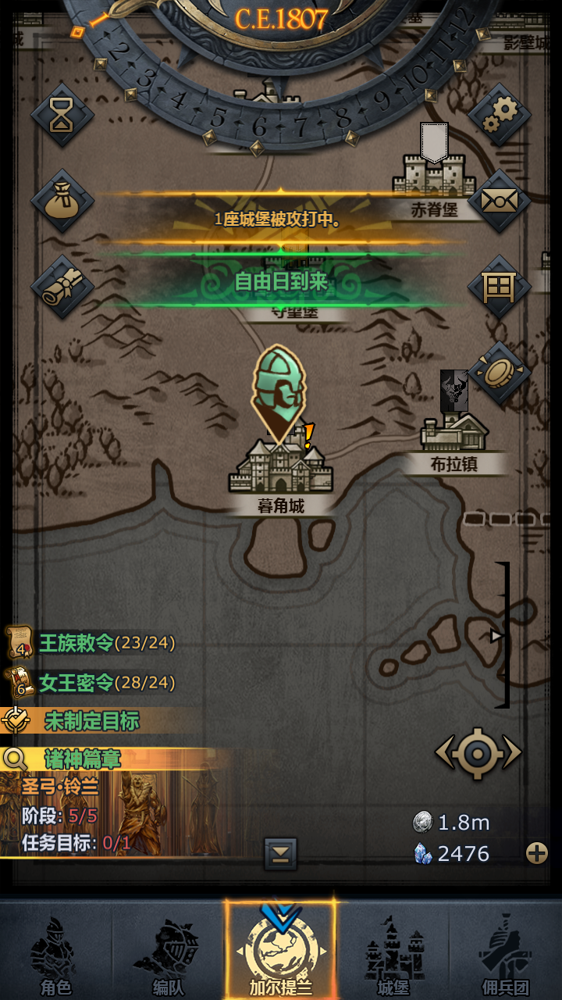
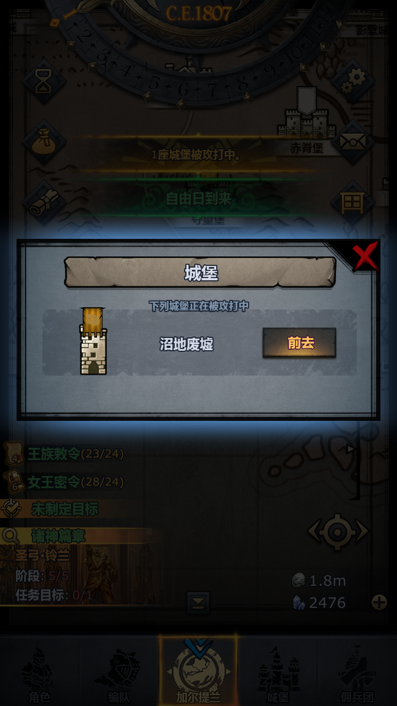

# 事件：城堡被攻打

> 实机流程于 2026-10-23 在 720×1280 上确认；识别节点在
> `resource/base/pipeline/event_utils.json`，处理器在
> `agent/action/fight/castle_defense_processor.py`。

## 1. 事件长什么样

大地图顶部会出现一条可点的橙色横幅：



点开后是「城堡」窗口，列出正在被攻打的城堡：


点「前去」进入防守窗口（显示进攻者等级、防守剩余时间、年产奖励）：



## 2. 处理流程

`CastleDefenseProcessor`（`Event_CastleDefense` / `Event_CastleAttack_Handle`）：

1. 识别横幅 `Event_CastleAttacked`（OCR「城堡被攻打」）；
2. 点横幅 → 等待「城堡」列表 `Event_CastleListWindow`（OCR「下列城堡正在被攻打」）；
3. 点「前去」`Event_CastleListGo`；
4. 等待防守窗口 `Event_CastleDefendWindow`（OCR「防守要塞 / 敌方攻击中」）；
5. 点「防守要塞」`Event_CastleDefendButton`；
6. 出现行路提示 `Event_CastleTravelDialog`（步行/乘船）时点「步行」的「确定」
   `Event_CastleTravelConfirm`；
7. 行路途中若有随机弹窗（如佣兵加入），点「取消」`Event_CastleInterruptCancel`
   继续；
8. 检测到战斗界面（`FightEndRound`）→ `AutoFight_Start` 打完整场（沿用月度循环的战斗基础配置）；
9. 处理胜利/失败结算，回到大地图。

选项「城堡被攻打处理」：

| 选项 | 行为 |
|---|---|
| 前往防守（默认） | 按上面流程点进去并打完 |
| 忽略 | 按返回键关闭窗口，放弃本次防守 |

该选项在「月度循环」里是基础配置（默认前往防守），专门任务「事件：城堡被攻打」
默认跟随月度循环，可单独覆盖。

## 3. 触发与入口

- **自动**：月度循环每次事件扫描都会检查横幅 / 列表 / 防守窗口，命中后调用
  `Event_CastleAttack_Handle`，无需额外配置；
- **手动**：任务列表「事件：城堡被攻打」，停在横幅或窗口上运行即可；
- 任务包同步：`tasks/Event_CastleDefense/`（`python tools/taskpack.py export --force` 生成）。

## 4. 识别节点

| 节点 | 识别 | 作用 |
|---|---|---|
| `Event_CastleAttacked` | OCR「城堡被攻打 / 座城堡被攻打」 | 地图横幅 |
| `Event_CastleAttackBannerClick` | 同上 + Click | 点横幅 |
| `Event_CastleListWindow` | OCR「下列城堡正在被攻打 / 正在被攻打中」 | 城堡列表窗口 |
| `Event_CastleListGo` | OCR「前去」+ Click | 点「前去」 |
| `Event_CastleDefendWindow` | OCR「防守要塞 / 敌方攻击中」 | 防守窗口 |
| `Event_CastleDefendButton` | OCR「防守要塞」+ Click | 点「防守要塞」 |
| `Event_CastleAttackText` | OCR 全屏 | 调试日志用 |

## 5. 校准

处理器每次识别都会把画面文字写进日志：

```text
城堡被攻打：画面文字=1座城堡被攻打中。 | 下列城堡正在被攻打中 | 前去 | 防守要塞 | ...
```

如果游戏版本更新导致文案变化，按日志里的实际文字修改 `event_utils.json`
对应节点的 `expected` 即可；坐标 ROI 也按截图调整。

## 6. 自检

```powershell
cd dist\Knights-web-windows
.\python\python.exe tools\selftest_castle_event.py
```

用假 Context 走「横幅 → 列表 → 防守窗口 → 战斗 → 胜利」和「忽略」两条路径，
不连接设备。
