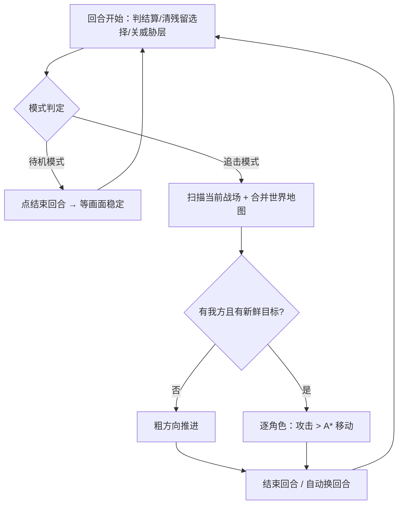

# 战斗模式与棋子识别

> 对应代码：`agent/action/zshg/auto_fight_processor.py`、`agent/action/zshg/battle_pieces.py`、
> `agent/action/zshg/battle_world_map.py`。选项定义在 `interface.json`，
> 选项节点在 `resource/base/pipeline/fight_utils.json`。

## 1. 战斗模式

战斗处理器现在显式区分两种模式，每回合开头判定一次：

| 模式 | 行为 | 代价 |
|---|---|---|
| **待机模式** | 只点「结束回合」，靠游戏自动反击让敌人走过来；不建图、不搜索、不移动 | 最低 |
| **追击模式** | 建图 → 顺时针/螺旋搜索 → 粗方向推进 → 八方向 A* 接近攻击环 → 点对点攻击 | 较高 |

界面选项「战斗模式」决定整场怎么走：

- `自动（先待机后追击）`（默认）：前 N 回合待机，第 N+1 回合起追击；
- `只待机`：整场不主动接近；
- `只追击`：第 1 回合就追击。

「待机回合数」N 默认 20，填 0 表示立刻追击。N 按**整场战斗累计回合**计算
（`BattleSessionState.confirmed_rounds`），AutoFightProcessor 被恢复逻辑再次
调用时不会重新等 N 回合。

**月度循环（Auto_YearlyTask）同样暴露这三个选项。** 进入战斗前，
`fight_utils.battle_option_override()` 会从当前任务上下文读取显式值，并通过
`pipeline_override` 传给嵌套的 `AutoFight_Start`——嵌套任务不保证继承父任务的
override，显式传下去才能保证月度循环不再固定 20 回合。未配置时仍用节点默认
（先待机 20 回合）。海盗事件的战斗也走同一套传递。

### 1.1 基础配置与专用任务覆盖

**月度循环是基础配置**：专门任务里与月度循环同名的选项，默认跟随月度循环：

- 网页版任务面板会把这类选项显示成「跟随月度循环（当前：…）」；
- 待机回合数等输入项留空 = 跟随；填数字 = 只对这个任务覆盖；
- 下拉项选「跟随月度循环」= 继承；选具体值 = 覆盖；
- 运行时 `Runtime.build_override()` 先取专门任务的显式选择，没有/为跟随
  时才用 `config/webapp.json` 里 `selections.Auto_YearlyTask` 的值。

升级到该机制后第一次启动网页版，会把旧版只存在于「战斗任务主动」里的
战斗设置一次性迁移到月度循环（`server.migrate_battle_base_config()`），
并把那个任务恢复成跟随，避免它继续当显式覆盖。



实现细节：

- `MODE_LABELS` / `_resolve_mode()` / `_load_battle_options()`；
- 待机分支不再扫描网格，避免无意义开销；
- 每次模式切换会打一条 `当前战斗模式切换为「…」` 日志；
- 测试用环境变量 `MAAGC_TEST_ACTIVE_FROM_ROUND` 仍可覆盖 N。

## 2. 缺我方 / 缺目标的「粗方向推进」

追击模式下，如果当前视野和全局地图都定位不到敌人（或连我方都看不到），
不再原地结束回合，而是先确定敌我大致方向，再让棋子朝那个方向走：

1. **找回我方**：`_focus_known_ally()` 用世界地图里记住的我方坐标平移镜头；
   失败则 `_find_allies()` 做小螺旋搜索。
2. **确定方向**（按可信度）：
   - 威胁覆盖区的锯齿空洞 / 可信红色连通框 → `_hidden_enemy_direction()`；
   - 跨回合敌人方向记忆（最多沿用 6 回合）；
   - 世界地图里未探索样本最多的方向 → `_frontier_direction()`（已撞过边界的方向降权）；
   - 最后才用上次移动方向兜底。
3. **推进**：对每名可操作棋子执行与正常追击相同的决策
   （`_decide_and_act`，此时 `pursuit_direction` 已知、没有精确敌人格），
   选择方向投影最优的蓝格移动并做像素级验证；确认移动后结束本回合，
   下一回合重新建图再走下一步。
4. 连续 12 个回合都没有任何可验证动作才放弃，交回外层恢复。

方向记忆会写回 `BattleSessionState.last_enemy_direction`，恢复调用可继续沿用。

## 3. 棋子识别

### 3.1 数据来源（越靠前越可信）

1. **实测范围**：选中棋子后同一帧的黄色攻击范围 / 蓝色移动范围，
   换算成相对棋子所在格的 `(d_row, d_col)` 偏移集合；
2. **人物卡 OCR**：`Battle_RoleCardText` 节点读取卡面文字，与
   `table/high_blood_names.json` 的姓名库、`table/piece_profiles.json`
   的职业/技能词表做精确、包含、相似度（阈值 0.72）三级匹配；
3. **配置表**：`table/piece_profiles.json` 中按棋子名/职业登记的技能与
   静态攻击范围；实测存在时永远以实测为准。

### 3.2 输出

每次选中棋子都会输出一行日志：

```text
棋子识别: 名字=贾艾斯 职业=弓箭手 技能=连射、精准 攻击范围=十字直线3格(实测6格/最远3格) 移动范围=8格 置信度=1.00 来源=实测范围 格子=(4,2)
```

- 整场战斗的识别结果保存在 `BattleSessionState.pieces`，战斗结束由
  `fight_utils._finish()` 汇总为 `本场棋子识别: …`；
- 每次识别追加到 `debug/pieces/<日期>.jsonl`；
- 实测攻击范围合并进 `table/piece_observations.json`（原子写入，保留 `.bak`），
  下次遇到同名棋子可直接复用，也可复制到 `piece_profiles.json`。

### 3.3 对战斗的作用

- `_piece_attack_targets()`：当黄色攻击角标被人物立绘遮住时，用实测攻击范围
  判断敌人是否真的在攻击范围内，命中则直接双击，不再只限「八方向相邻」；
- 攻击前的目标排序、移动决策仍然完全沿用原有的 A* 与验证逻辑，识别结果
  只是补强，不会绕过动作验证。

### 3.4 `table/piece_profiles.json`

```jsonc
{
  "card_roi": [0, 120, 460, 430],   // 人物卡 OCR 区域（x, y, w, h）
  "command_words": ["攻击", "技能", "待机"],  // 卡面指令文字，不当姓名/技能
  "skill_vocabulary": ["连射", "冲锋"],       // 已知技能名，用于卡面文字匹配
  "jobs": {
    "弓箭手": {"skills": [{"name": "连射", "kind": "主动", "range": "3格"}]}
  },
  "pieces": {
    "贾艾斯": {
      "job": "弓箭手",
      "skills": [{"name": "连射", "kind": "主动", "range": "3格"}],
      "attack_range": [[-3, 0], [-2, 0], [-1, 0], [1, 0], [2, 0], [3, 0]]
    }
  }
}
```

- `attack_range` 留空 = 完全依赖实测与历史实测；
- 以 `_` 开头的键（如 `_示例（可删除）`）不参与匹配；
- 表在进程启动时读入内存：改完表后重启网页版/Agent 生效；
  代码里也可以调用 `PieceRecognizer.reload()` 立即重读。

### 3.5 校准建议

1. 跑一场战斗（建议「只追击」+ 棋子识别开启），看日志里的
   `棋子识别: …` 与 `debug/pieces/*.jsonl`；
2. 如果名字识别不出来，说明 `card_roi` 没盖住姓名区域：把一张选中棋子的
   截图（720×1280）对照 `card_roi` 调整，或先看 `debug/pieces` 里的
   `card_text` 是否包含姓名；
3. 如果技能一直是「未识别」，把游戏里显示的技能名填进
   `skill_vocabulary`，或按棋子名/职业登记 `skills`。

### 3.6 单独诊断任务

界面任务「功能：棋子识别（战斗中）」（`BattlePieceProbe`）：

1. 在战斗中选中一名我方棋子（出现攻击/移动范围）；
2. 运行该任务；
3. 日志会输出 `棋子识别: …` 与 `人物卡文字=[…]`，并把实测范围写入
   `table/piece_observations.json`、`debug/pieces/<日期>.jsonl`。

它不点结束回合、不移动棋子，只在当前帧做一次识别，适合在调整
`card_roi` / `skill_vocabulary` 后快速验证。

## 4. 相关文件

| 文件 | 作用 |
|---|---|
| `agent/action/zshg/auto_fight_processor.py` | 模式状态机、粗方向推进、棋子识别接入、攻击决策 |
| `agent/action/zshg/battle_pieces.py` | 棋子识别器（范围实测 / 卡面 OCR / 配置表 / 观测落盘） |
| `agent/action/zshg/battle_piece_probe.py` | 「功能：棋子识别（战斗中）」诊断任务 |
| `agent/action/zshg/battle_world_map.py` | 世界地图、会话状态（回合数/方向记忆/棋子记录） |
| `resource/base/pipeline/fight_utils.json` | 选项节点 `FightModeSelect` / `FightStandbyRounds` / `FightPieceRecognition` / `BattlePieceProbe` |
| `resource/base/pipeline/battle_grid.json` | `Battle_RoleCardText` 人物卡 OCR 节点 |
| `table/piece_profiles.json` | 棋子技能与静态攻击范围配置 |
| `table/piece_observations.json` | 自动实测结果（运行时生成） |
| `tools/selftest_battle_modes.py` | 离线自检（不需要设备） |

## 5. 自检

```powershell
cd dist\Knights-web-windows
.\python\python.exe tools\selftest_battle_modes.py
```

自检覆盖：范围实测与签名、姓名匹配、无 OCR 时的识别降级、选项读取与
模式判定、未探索边界方向、按实测范围补齐攻击目标、观测表落盘。
