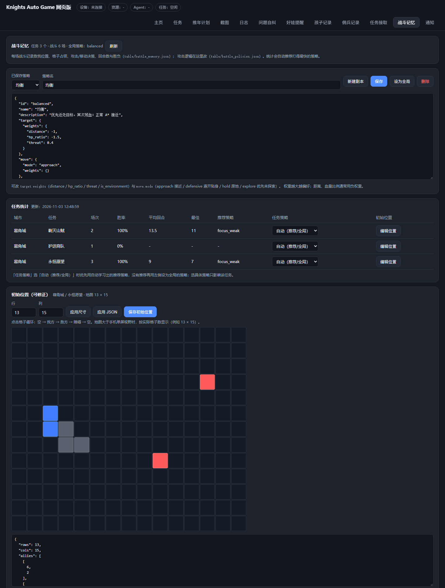
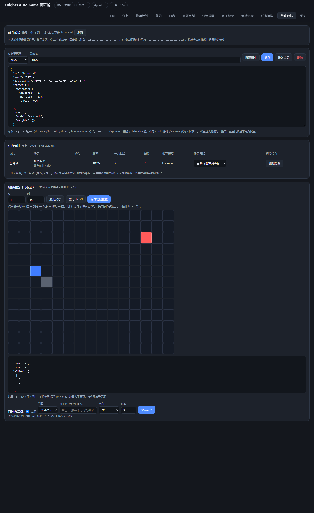
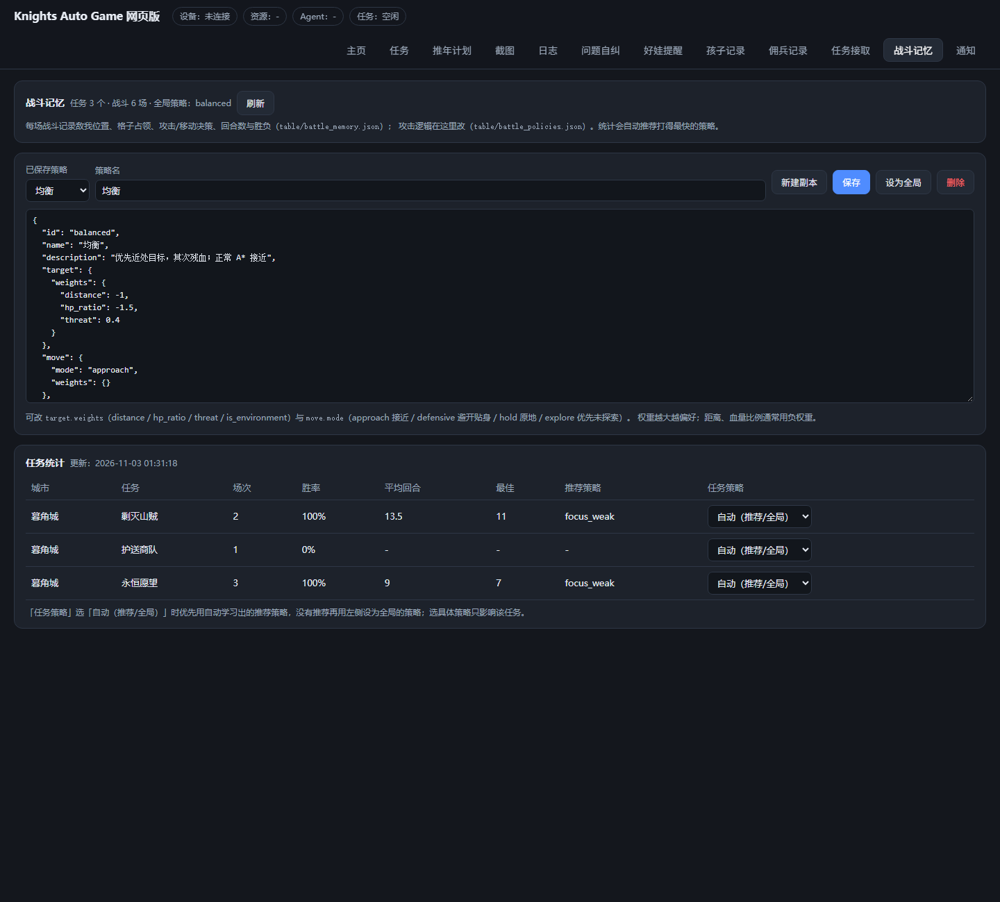

# 战斗记忆与攻击策略

> 目标：每场战斗都留下可复盘的数据，玩家能改攻击逻辑，脚本按「打得更快」自动选任务。
> 代码：`agent/utils/battle_memory.py`；数据：`table/battle_memory.json`、`table/battle_policies.json`；
> 面板：网页「战斗记忆」。

## 1. 记录什么

每场战斗结束后，`table/battle_memory.json` 会为「城市/任务」追加一条 run：

```json
{
  "time": "2026-11-03 01:20:00",
  "rounds": 7,
  "result": "胜利",
  "policy": "focus_weak",
  "initial": {
    "round": 1,
    "allies": [[5, 2], [6, 2]],
    "enemies": [[2, 7]],
    "environment": []
  },
  "occupancy": [ { "round": 1, "allies": [], "enemies": [] } ],
  "decisions": [
    { "round": 1, "action": "move", "from": [5, 3], "to": [5, 4], "target": [5, 4], "piece": "甲" },
    { "round": 2, "action": "attack", "from": [4, 4], "to": [3, 7], "target": [3, 7], "piece": "甲" }
  ],
  "pieces": { "甲": { "range_class": "近战", "round_seen": 3 } }
}
```

同时更新该任务的统计：

- `runs / wins / losses / win_rate`
- `avg_rounds`（只按胜利场次）、`best_rounds`、`last_rounds`
- `policies.<策略id>`：每个策略的场次、胜场、平均回合
- `recommended`：按「胜场多、平均回合少」自动选出的推荐策略
- `opening`：开局我方/敌方格子出现次数（位置热力图）

每任务最多保留最近 30 场、每场最多 80 条决策；文件不会无限增长。

## 2. 初始位置与地图尺寸（可人工修正）

第一次进入某个战斗任务时，处理器会把观测到的世界地图范围记下来：

- `map.rows × map.cols`：实际地图格数（行 × 列），例如 `13 × 15`；
- `map.view`：手机单屏视野（默认 `10 × 6` 格，120px/格）；
- `screen_limited`：地图是否大于手机屏幕（行×120 > 1280 或 列×120 > 720）；
- `map.allies / enemies / blocked`：归一化后的我方、敌方、障碍格子（0 基）。

地图比屏幕大时，随着镜头平移，世界坐标跨度会变大；到战斗结束取并集，
得到实际地图尺寸。这样界面可以按 `13 × 15` 完整显示，而不是只显示一屏。



网页「战斗记忆」任务表每行有「编辑位置」：

- 点击格子循环：空 → 我方（蓝）→ 敌方（红）→ 障碍（灰）→ 空；
- 行/列输入框改地图尺寸，「应用尺寸」会裁掉越界格子；
- 也可以直接改 JSON（`rows / cols / allies / enemies / blocked`）后点「应用 JSON」；
- 保存后 `map.source = "user"`，之后自动测量不会覆盖用户修正。

接口：`POST /api/battle-memory/map`，请求体 `{key: "城市/任务", map: {...}}`。

### 八方向相对位置

每次进入战斗、每次位置快照都会计算并记录：

```json
{
  "allies": 3,
  "enemies": 2,
  "ally_center": [5.0, 2.0],
  "enemy_center": [2.0, 7.0],
  "vector": [-3, 5],
  "direction": "NE",
  "label": "东北",
  "distance": 5
}
```

- 方向按 8 个方向量化：北 N、东北 NE、东 E、东南 SE、南 S、西南 SW、西 W、西北 NW
  （row 增大 = 南，col 增大 = 东）；
- 每场战斗的 run 里保存 `relation`；任务上保存最近一次 `last_relation` 和最近 20 场
  `relations`；网页任务表会显示「敌在东北 · 5格」；
- 主动模式开始时会读取这个方向，在没有视野时作为推进方向；实际优先级是
  「当前威胁覆盖区 > 上次回合方向 > 战斗记忆记录方向 > 未探索边界 > 上次移动方向」，
  避免旧数据压过当前画面，同时待机很久后仍能朝记录的敌我相对方向走。

### 首回合走位（玩家脚本）



网页「初始位置」下方可以给每个任务配一个简单走位：

- 范围：全部棋子 / 单个棋子（单个可填棋子名，留空 = 第一个可行动棋子）；
- 方向：八个方向任选；
- 格数：1~6（实际受该棋子蓝色移动范围限制，取方向投影内最接近的蓝格）；
- 回合：默认第 1 回合。

```json
{
  "enabled": true,
  "target": "all",
  "piece": "",
  "direction": "E",
  "cells": 3,
  "round": 1
}
```

行为：

1. 该回合强制进入主动模式（即使设置里还在待机回合内），否则无法选人移动；
2. 每个符合条件的棋子选中后，向指定方向找蓝格移动，最多 `cells` 格；
3. 单个棋子时只走一个，其余棋子按正常攻击/待机逻辑；
4. 全部棋子时每个棋子走一次，走完本回合结束；
5. 走位失败（没有对应蓝格/被拒绝）会记日志并按正常逻辑继续。

保存接口：`POST /api/battle-memory/opening`，请求体 `{key, opening}`。

## 3. 攻击逻辑怎么改

`table/battle_policies.json`（网页可直接编辑）结构：

```json
{
  "active": "balanced",
  "policies": {
    "balanced": {
      "id": "balanced",
      "name": "均衡",
      "target": {
        "weights": { "distance": -1.0, "hp_ratio": -1.5, "threat": 0.4 }
      },
      "move": { "mode": "approach" },
      "flags": { "attack_occluded": true }
    }
  },
  "tasks": { "暮角城/永恒愿望": "focus_weak" }
}
```

### 目标评分

每次选中我方棋子后，对每个可攻击敌人算特征，再按权重求和，取最高分：

| 特征 | 含义 | 常用权重 |
|---|---|---|
| `distance` | 屏幕距离 / 100（越小越好） | 负数，如 `-1.0` |
| `hp_ratio` | 敌人红色血条长度 / 本组最大值（1=最满，越小越残） | 负数越大越集火残血，如 `-3.0` |
| `threat` | 预留：威胁度（当前恒 0，后续可接威胁层） | `0.4` |
| `is_environment` | 1=环境目标（箱子/障碍） | 默认 0 |

想「优先残血」：把 `hp_ratio` 调到 `-3` 左右；想「先打最近的」：把 `distance` 调到 `-2`、`hp_ratio` 调到 `-0.5`。
权重全为 0 或没有策略时，退回原来的「最近目标」。

### 移动模式

| `move.mode` | 行为 |
|---|---|
| `approach` | 正常八方向 A* 接近敌人/攻击环（默认） |
| `defensive` | 优先排除与敌人八方向相邻的落点，避免被贴身 |
| `hold` | 有敌人时不主动移动，只打进入攻击范围的目标 |
| `explore` | 优先走到世界地图未探索的格子（探索型打法） |

移动仍由原来的 A* / 绕障逻辑执行，策略只做候选过滤，不会破坏寻路。

### 任务分配

`tasks` 里按 `城市/任务` 显式指定策略；没指定的任务按「自动学习推荐 → 全局策略」取：
`policy_for()` = 显式分配 > 历史推荐（`recommended`）> `active`（全局）。
网页「战斗记忆」的任务表里每行有「任务策略」下拉，改完立即写入。
任务选项「战斗策略」也可以强制指定（优先级：任务选项 > 任务分配 > 学习推荐 > 全局）。

## 4. 自动学习

不是训练模型，而是可解释的统计学习：

1. 每场战斗结束 → 写入 run → 重算任务统计；
2. `recommended` = 胜场最多、平均回合最少的策略；下一场若该任务没有显式分配策略，会自动使用它（`policy_for()` 的推荐回退）；
3. `expected_rounds(城市, 任务)`：
   - 有推荐策略的胜利记录 → 该策略平均回合；
   - 只有失败 → 40 回合惩罚；
   - 完全未知 → 用同任务类型的平均值 ×1.1，没有类型则回退 `table/task_records.json`
     的旧平均回合；再没有则 18 回合（探索估计）；
4. 接任务时，「回合最少 / 均衡」按 `expected_rounds` 排序；未知任务用「乐观初始化」
   （已知最快任务 ×0.7）先获得一次采样机会，打过一场后就用真实回合数参与排序，不会被永久跳过；
5. 开局位置热力图（`opening`）用于后续扩展「推荐开局站位」，当前只记录不自动改变走位；
6. 探索：`settings.explore_every`（默认 5）控制每 5 场换一个「采样最少」的策略试打，
   避免推荐策略固定后其它策略永远没有样本；设为 0 关闭探索。

这样跑得越多，选任务越偏向「已知打得快」的任务，同时保留对未知任务的探索。

## 5. 网页面板

顶部「战斗记忆」：



- **策略编辑**：选择策略 → 直接改 JSON → 保存；「新建副本」从当前策略复制；
  「设为全局」把该策略设为所有未分配任务的默认；「删除」只能删自定义策略；
- **任务统计**：场次、胜率、平均/最佳回合、推荐策略、每任务策略下拉；
- **初始位置**：任务行「编辑位置」→ 图形格子点击修正 → 保存；地图尺寸按
  `rows × cols`（例如 13 × 15）显示，大于单屏时标注；
- 数据实时读文件，Agent 跑完一场后刷新即可看到。

接口（网页内部使用）：

```
GET  /api/battle-memory
POST /api/battle-memory/policy      {name, policy}
POST /api/battle-memory/active      {name}
POST /api/battle-memory/assign      {key, policy}
POST /api/battle-memory/map         {key, map}
POST /api/battle-memory/opening     {key, opening}
POST /api/battle-memory/policy/delete {name}
```

## 6. 接入点

| 位置 | 作用 |
|---|---|
| `AutoFightProcessor.run()` | 战斗开始 `battle_memory.start(...)`；每回合 `_trace_snapshot` 记录位置 |
| `_trace_snapshot()` | 调 `observe_world()` 测量地图；待机模式首回合也会补一次扫描 |
| `_compute_relation()` | 每次快照算我方/敌方中心、八方向与距离 |
| `_opening_move_target()` | 首回合按玩家的方向/格数选蓝格并移动 |
| `_resolve_mode()` | 首回合走位/战斗策略需要时强制进入主动模式 |
| `_decide_and_act()` | 攻击/移动决策写入 `battle_memory.decision(...)`；目标评分用当前策略 |
| `_pick_attack_target()` | 按 `target.weights` 选目标（无权重回退最近） |
| `_apply_move_policy()` | `defensive/hold/explore` 过滤移动候选 |
| `fight_utils._finish()` | 战斗结束写 run、统计与推荐策略；回合数用 `total_rounds()` |
| `fight_utils._accept_new_task()` | 读 `TaskSelectSelect`，按预计回合排序 |
| `battle_option_override()` | 把「战斗策略」选项传给嵌套的 `AutoFight_Start` |
| `battle_memory.save_map()` | 保存用户修正的初始位置（`source=user`） |
| `battle_memory.save_opening()` | 保存首回合走位方案（全部/单个、方向、格数） |

### 回合数修正

原先有两个问题：

1. `session_key()` 用 `id(tasker):id(controller)` 拼 key。Maa 给每个
   CustomAction 回调的包装对象都是新的，`_process_fighting` 和
   `AutoFightProcessor` 实际各拿一个会话：一个累计了 20 回合，收尾读到的
   却是另一个 0 回合会话，任务记录就变成 1 回合（历史 486 条里 480 条为 0）。
   现在改用进程级固定 key `"battle"`，并在收尾时取「本地引用/注册表」中
   回合数更多的会话。
2. 回合数改为「实际发生过行动的最后一回合」：

   - 第 1 回合就击杀 → 1 回合；
   - 第 20 回合结束、进入第 21 回合时因持续伤害结算 → 仍记 20 回合；
   - 结算时到达的回合号另存为 `rounds_reached`，日志显示
     「20 回合（行动到第 20 回合，结算于第 21 回合）」。

任务记录、战斗记忆都用 `rounds`；旧版 `task_records.json` 里 0/1 的
平均值低于 2，不再参与任务排序，避免把坏数据当成「0.1 回合最快」。

## 7. 限制与后续

- 血量特征用红条像素近似，没有真实 HP；不同棋子/皮肤的条长可能有偏差；
- 目前没有「技能释放」策略（技能由游戏自动/手动），只控制目标与移动；
- 地图尺寸来自世界坐标观测并集，未探索到的边缘可能偏小；可用网页「初始位置」直接修正行/列；
- 位置记录是格子坐标（局部/世界网格），开局热力图仅供参考；
- 任务类型来自 HUD 的任务标签（如「斩杀任务」），用于未知任务的兜底估计；
- 后续可加：按棋子职业分配策略、技能优先级、开局站位推荐、按敌方阵容匹配策略。

## 8. 自检

```powershell
cd dist\Knights-web-windows
.\python\python.exe tools\selftest_battle_memory.py
```

覆盖：默认策略、目标评分、两场记录、平均/最佳回合、推荐策略、开局位置、按回合排序、
任务分配、自定义策略保存、全败惩罚、旧记录兜底、探索轮换与乐观任务采样、
地图自动测量/初始位置归一化/用户修正、会话 key 稳定性/回合数语义/结算回合、
八方向量化/敌我相对位置/首回合走位目标选择，以及战斗处理器实际按策略选目标/过滤移动。
共 50 项。

